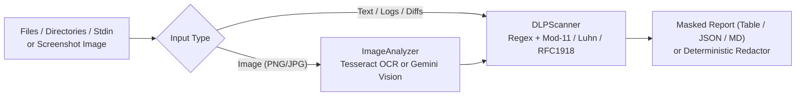

**🇺🇸 English** | [🇧🇷 Português](README.pt-BR.md)

# 🛡️ pii-screenshot-guard

[](https://github.com/gavicoding/pii-screenshot-guard/actions/workflows/ci.yml)
[](https://gavicoding.github.io/pii-screenshot-guard/)
[](https://www.python.org/downloads/)
[-brightgreen.svg)](pyproject.toml)
[](LICENSE)

A **Zero-Trust Data Loss Prevention (DLP)** CLI, Python library, and **GitHub PR API Auditor** to detect **LGPD / GDPR PII**, **hardcoded API keys & tokens**, **database connection strings**, and **internal RFC 1918 network IPs** across logs, support tickets, PR diffs, and screenshots before they leave your environment.

🌐 **Documentation:** [https://gavicoding.github.io/pii-screenshot-guard/](https://gavicoding.github.io/pii-screenshot-guard/)

---

## In plain words

Pasting a log into a ticket, sharing a screenshot in chat or pushing a config file to GitHub is how most leaks happen: a customer's CPF, an internal server IP or an API key goes along with it.

This tool checks the text (or the image) **before** you share it and masks what should not leave.

**What you gain**

- **Leaks stopped before they happen:** run it in CI and fail the pull request that tries to push a password or a CPF.
- **Very few false alarms:** CPF and CNPJ are validated by their check digits and cards by the Luhn algorithm, so any random 11-digit number is not treated as a CPF.
- **The report does not leak either:** results only show a masked preview (e.g. `529***25`).

---

## Why Use It?

Sharing terminal logs, screenshots, or config snippets in support tickets, Slack/Teams, or social posts is one of the fastest ways internal IPs, customer CPFs, and API tokens leak. `pii-screenshot-guard` gives developers and IT teams:

- **Zero Core Dependencies:** Runs out of the box on Python 3.10+ using pure standard library modules.
- **Checksum-Verified PII Detection:** Validates Brazilian **CPF** & **CNPJ** (mod-11 check digits) and **Payment Cards** (Luhn algorithm) to dramatically cut false positives.
- **Zero-Exposure Reporting:** Reports always print **masked previews** (e.g., `AKI***LE`) - raw secrets are never echoed back into CI logs.
- **CI / Pre-Commit Ready:** Supports `--fail-on low|medium|high|critical`, `--format table|markdown|json`, stdin piping (`-`), and deterministic redaction (`redact`).
- **Extensible Image / Screenshot Auditing:** Includes pluggable `TesseractOCRAnalyzer` (offline OCR) and `GeminiVisionAnalyzer` (multimodal DLP gate via `GEMINI_API_KEY`).

---

## Architecture



---

## Quick Start

### Install

```bash
pip install .
```

*(Or run directly with `PYTHONPATH=src python -m pii_guard ...` without installing.)*

### Scan Files, Directories, or Stdin

```bash
# Scan a folder and fail CI on medium+ severity leaks
pii-guard scan ./logs --fail-on medium --format markdown

# Scan piped output before pasting to a ticket
git diff | pii-guard scan - --format table

# Redact sensitive values into a sanitized file
pii-guard redact app.log -o app.sanitized.log

# Audit added lines of a GitHub Pull Request via REST API (and optionally comment)
export GITHUB_TOKEN="<your_github_token>"
pii-guard github-pr --repo gavicoding/pii-screenshot-guard --pr 1 --format markdown --comment
```

Exit codes: `0` clean (below `--fail-on`), `1` findings at or above `--fail-on`, `2` a path does not exist or a file cannot be read.

### Example Output

```text
ALERT: 2 finding(s) detected across 1 target(s).
SEVERITY | RULE_ID                   | SOURCE:LINE        | MASKED_VALUE
---------+---------------------------+--------------------+----------------------
HIGH     | BR_CPF                    | ticket.log:1       | 529***25
MEDIUM   | INTERNAL_IPV4             | ticket.log:1       | 10.***3
```

---

## Detected Rules

| Rule ID | Category | Severity | Verification |
| :--- | :--- | :--- | :--- |
| `PRIVATE_KEY_BLOCK` | Secrets | `CRITICAL` | PEM private key header |
| `AWS_ACCESS_KEY` | Secrets | `CRITICAL` | `AKIA` / `ASIA` 20-char key format |
| `GITHUB_TOKEN` | Secrets | `CRITICAL` | `ghp_`, `gho_`, `ghu_`, `ghs_`, `ghr_`, `github_pat_` |
| `DB_CONNECTION_STRING` | Secrets | `CRITICAL` | URI with embedded `user:pass@host` |
| `JWT_TOKEN` | Secrets | `HIGH` | 3-part base64url JWT structure |
| `GENERIC_SECRET_ASSIGNMENT` | Secrets | `HIGH` | Key/password assignment (filters placeholders) |
| `CREDIT_CARD` | PCI / PII | `HIGH` | Luhn checksum validated |
| `BR_CPF` | LGPD PII | `HIGH` | Mod-11 check digits validated |
| `US_SSN` | GDPR / PII | `HIGH` | SSN format excluding invalid blocks |
| `BR_CNPJ` | LGPD Corp | `MEDIUM` | Mod-11 check digits validated |
| `INTERNAL_IPV4` | Infra Leak | `MEDIUM` | Strict RFC 1918 (`10/8`, `172.16/12`, `192.168/16`) |
| `EMAIL_ADDRESS` | LGPD / GDPR | `LOW` | Standard email pattern |
| `BR_PHONE` | LGPD PII | `LOW` | Brazilian phone pattern |

---

## Optional Screenshot DLP (OCR / Multimodal Vision)

```python
from pathlib import Path
from pii_guard.vision import TesseractOCRAnalyzer, GeminiVisionAnalyzer

# Option A: 100% offline via local Tesseract binary
findings = TesseractOCRAnalyzer().analyze_image(Path("screenshot.png"))

# Option B: Multimodal Vision audit (reads GEMINI_API_KEY from environment)
findings = GeminiVisionAnalyzer().analyze_image(Path("screenshot.png"))
```

---

## Run with Docker

```bash
docker build -t pii-screenshot-guard .
docker run --rm -i pii-screenshot-guard scan - < sample.log
```

---

## License

Apache License 2.0 - see [LICENSE](LICENSE).
