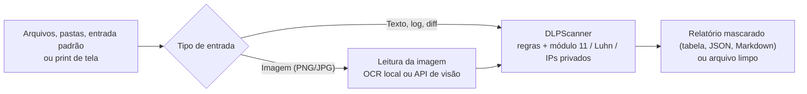

[🇺🇸 English](README.md) | **🇧🇷 Português**

# 🛡️ pii-screenshot-guard: detector de dados pessoais e senhas

[](https://github.com/gavicoding/pii-screenshot-guard/actions/workflows/ci.yml)
[](https://gavicoding.github.io/pii-screenshot-guard/)
[](https://www.python.org/downloads/)
[](pyproject.toml)
[](LICENSE)

Procura **CPF, CNPJ, cartão de crédito, e-mail, telefone, senhas, chaves de API, tokens e IPs internos** em logs, arquivos, pull requests e prints de tela, e **mascara** o que encontrar antes que isso saia da sua equipe. Funciona como comando, como biblioteca Python ou como etapa do CI.

🌐 **Documentação:** [https://gavicoding.github.io/pii-screenshot-guard/](https://gavicoding.github.io/pii-screenshot-guard/)

---

## Para que serve

Um dos jeitos mais comuns de vazar dado é o mais inocente: alguém cola um log num chamado, manda um print no chat ou sobe um arquivo de configuração no GitHub. Junto vão o CPF de um cliente, o IP de um servidor interno ou uma chave de API.

Esta ferramenta confere o texto (ou a imagem) **antes** de você compartilhar e mostra o que precisa ser escondido.

## O que você ganha

- **Vazamento barrado antes de acontecer:** dá para rodar no CI e reprovar o pull request que tenta subir uma senha ou um CPF.
- **Quase nenhum alarme falso:** CPF e CNPJ são validados pelo dígito verificador (módulo 11) e cartões pelo algoritmo de Luhn. Um número qualquer com 11 dígitos não é tratado como CPF.
- **O relatório também não vaza:** o resultado mostra só uma prévia mascarada (ex.: `529***25`), nunca o valor completo, então o log do próprio CI continua seguro.
- **Nada para instalar além do Python:** usa só a biblioteca padrão do Python 3.10+.

---

## Como funciona



---

## Como usar

### Instalação

```bash
pip install .
```

*(Ou rode sem instalar: `PYTHONPATH=src python -m pii_guard ...`.)*

### Conferir arquivos, pastas ou o que vier por pipe

```bash
# Conferir uma pasta e falhar o CI se houver achado de gravidade média ou maior
pii-guard scan ./logs --fail-on medium --format markdown

# Conferir a saída de um comando antes de colar num chamado
git diff | pii-guard scan - --format table

# Gerar uma cópia do arquivo com os dados sensíveis mascarados
pii-guard redact app.log -o app.sanitized.log

# Conferir as linhas adicionadas de um pull request no GitHub (e, se quiser, comentar nele)
export GITHUB_TOKEN="<seu_token_github>"
pii-guard github-pr --repo gavicoding/pii-screenshot-guard --pr 1 --format markdown --comment
```

### Exemplo de resultado

```text
ALERT: 2 finding(s) detected across 1 target(s).
SEVERITY | RULE_ID                   | SOURCE:LINE        | MASKED_VALUE
---------+---------------------------+--------------------+----------------------
HIGH     | BR_CPF                    | ticket.log:1       | 529***25
MEDIUM   | INTERNAL_IPV4             | ticket.log:1       | 10.***3
```

As mensagens da ferramenta são em inglês.

---

## O que é detectado

| Regra | Categoria | Gravidade | Como é conferido |
| :--- | :--- | :--- | :--- |
| `PRIVATE_KEY_BLOCK` | Segredos | `CRITICAL` | Cabeçalho de chave privada PEM |
| `AWS_ACCESS_KEY` | Segredos | `CRITICAL` | Formato de chave `AKIA` / `ASIA` com 20 caracteres |
| `GITHUB_TOKEN` | Segredos | `CRITICAL` | `ghp_`, `gho_`, `ghu_`, `ghs_`, `ghr_`, `github_pat_` |
| `DB_CONNECTION_STRING` | Segredos | `CRITICAL` | Endereço de banco com `usuario:senha@servidor` |
| `JWT_TOKEN` | Segredos | `HIGH` | Estrutura JWT em 3 partes (base64url) |
| `GENERIC_SECRET_ASSIGNMENT` | Segredos | `HIGH` | `senha=...`, `api_key=...` (ignora valores de exemplo) |
| `CREDIT_CARD` | Cartão / dado pessoal | `HIGH` | Validado pelo algoritmo de Luhn |
| `BR_CPF` | Dado pessoal (LGPD) | `HIGH` | Validado pelo dígito verificador (módulo 11) |
| `US_SSN` | Dado pessoal (GDPR) | `HIGH` | Formato de SSN, descartando blocos inválidos |
| `BR_CNPJ` | Dado de empresa (LGPD) | `MEDIUM` | Validado pelo dígito verificador (módulo 11) |
| `INTERNAL_IPV4` | Infraestrutura | `MEDIUM` | Só faixas privadas (`10/8`, `172.16/12`, `192.168/16`) |
| `EMAIL_ADDRESS` | Dado pessoal | `LOW` | Padrão de e-mail |
| `BR_PHONE` | Dado pessoal (LGPD) | `LOW` | Padrão de telefone brasileiro |

---

## Prints de tela (opcional)

Para imagens, o texto é lido primeiro e depois passa pelas mesmas regras:

```python
from pathlib import Path
from pii_guard.vision import TesseractOCRAnalyzer, GeminiVisionAnalyzer

# Opção A: 100% local, usando o Tesseract instalado na máquina
findings = TesseractOCRAnalyzer().analyze_image(Path("screenshot.png"))

# Opção B: API de visão (lê a chave da variável de ambiente GEMINI_API_KEY)
findings = GeminiVisionAnalyzer().analyze_image(Path("screenshot.png"))
```

Se o print não pode sair da sua rede, use a opção A.

---

## Com Docker

```bash
docker build -t pii-screenshot-guard .
docker run --rm -i pii-screenshot-guard scan - < sample.log
```

## Testes

```bash
PYTHONPATH=src python -m unittest discover -s tests -v
```

---

## Licença

Apache License 2.0. Veja [LICENSE](LICENSE).
